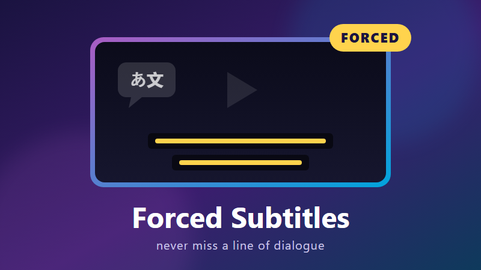

<p align="center">
  
</p>

<h1 align="center">Forced Subtitles for Jellyfin</h1>

<p align="center">
  Automatically fills in missing <b>forced</b> and <b>foreign-language</b> subtitles from OpenSubtitles.com,
  so you never miss a line of dialogue.
</p>

<p align="center">
  <a href="https://github.com/TNT24/jellyfin-forced-subtitles/releases/latest"></a>
  
  
</p>

---

## Why?

You're watching an English film and a character suddenly speaks Russian, Klingon or Elvish. On the disc those lines
come with **forced subtitles**: a small track that only shows the foreign dialogue. Rips and downloads often lose it,
and Jellyfin's subtitle search doesn't make it easy to find.

This plugin goes through your library, works out what each video is missing, and fetches exactly that:

| Your video | What the plugin does |
|---|---|
| Audio in your language, **no forced subtitle** | Downloads a **forced** subtitle (foreign lines only), **if OpenSubtitles has one**. It never falls back to a full subtitle you didn't ask for. |
| Audio in **another language**, no subtitle in your language | Downloads a **full** subtitle in your language (can be turned off). |
| Already has the right subtitle, embedded or external | Does nothing and makes no API calls. |

## Features

- **Checks locally first.** It reads the existing audio and subtitle tracks, so videos that are already covered never touch the API.
- **Smart matching.** It ranks exact file-hash matches first, then release-name similarity, trusted uploaders, non-SDH and popularity. Machine translations are skipped.
- **Runs by itself.** It runs as a daily scheduled task and after every library scan, and there's a **Run now** button.
- **Remembers results.** Nothing is downloaded twice, and titles with no forced subtitle aren't searched again until a set number of days has passed.
- **Keeps media folders clean.** Subtitles go to Jellyfin's metadata folder by default, or next to the video if you prefer.
- **Adds a manual search source.** Jellyfin's *Edit subtitles → Search* dialog gets an **OpenSubtitles (Forced aware)** source, with forced results tagged `[FORCED]`.
- **Reuses your login.** It can use the account you already set up in the official OpenSubtitles plugin.

---

## Installation

### From the plugin repository (recommended)

1. In Jellyfin, open **Dashboard → Plugins → Repositories** and click **+**.
2. Add the repository:
   - **Name:** `Forced Subtitles`
   - **URL:**
     ```
     https://raw.githubusercontent.com/TNT24/jellyfin-forced-subtitles/main/manifest.json
     ```
3. Go to **Catalog**, find **Forced Subtitles** under *Subtitles*, and click **Install**.
4. **Restart Jellyfin.**

Jellyfin picks the build that matches your server version, and new releases appear in the catalog as updates.

### Manual install

1. Download the zip for your server from the [latest release](https://github.com/TNT24/jellyfin-forced-subtitles/releases/latest):
   - `..._jellyfin-12.zip` for Jellyfin **12.x**
   - `..._jellyfin-10.11.zip` for Jellyfin **10.11.x**

   Your server version is shown under *Dashboard → General*.
2. Extract it into your Jellyfin plugins folder, and delete any older `ForcedSubtitles_*` folder:

   | Platform | Plugins folder |
   |---|---|
   | Windows | `%ProgramData%\Jellyfin\Server\plugins\` |
   | Linux | `/var/lib/jellyfin/plugins/` |
   | Docker | `/config/plugins/` |
3. Restart Jellyfin.

---

## Getting started

1. **Get an OpenSubtitles API key.** It's free: sign in at [opensubtitles.com](https://www.opensubtitles.com), go to
   *Profile → API consumers*, create a consumer and copy the key.
2. Open **Forced Subtitles** from the Jellyfin sidebar, or from *Dashboard → Plugins*.
3. Paste the key under **Advanced**. Enter your OpenSubtitles **username and password**, or leave them blank to reuse
   the official OpenSubtitles plugin's login.
4. Click **Test connection**. It confirms the login works and shows how many downloads you have left today.
5. Choose your libraries and click **Run now**, or wait for the nightly run.

## Settings

| Setting | Default | What it does |
|---|---|---|
| Subtitle language | `eng` | The language you want subtitles in (ISO 639-2). |
| Libraries | All movie and TV libraries | Which libraries to check. |
| Movies / TV episodes | Both on | Which kinds of video to check. |
| Full subtitles for foreign audio | On | Fetch a full subtitle when the audio isn't in your language. |
| Where to save | Metadata folder | Jellyfin's metadata folder, next to the video, or each library's own setting. |
| Check after library scans | On | Check newly added videos straight after a scan, in the background. |
| Require hash match | Off | Only accept subtitles made for your exact file. |
| Skip machine translations | On | Ignore AI or machine-translated subtitles. |
| Re-search after (days) | 14 | How long to wait before searching again for a video where nothing was found. |
| Max downloads per run | 20 | Stops each run at this many downloads to stay within your daily quota. |

The **Results** panel lists what was found, what was downloaded and what wasn't available, with **Run now**,
**Refresh** and **Forget history** buttons.

## Good to know

**Where do subtitles go?**
Jellyfin only picks up external subtitles that sit right next to the video or in its metadata folder. A subfolder
like `Movie/subtitles/` won't work. The default (metadata folder) leaves your media untouched. Pick **next to the
video** if other players such as VLC or Plex need the files too. Files are named `<video>.eng.forced.srt`, or
`<video>.eng.srt` for full subtitles.

**How does it decide what's missing?**
A subtitle counts as forced if its forced flag is set, or if its title or filename contains "forced" or "foreign".
The **default audio track** decides between forced and full. Audio marked as unknown (`und`) is treated as your
language.

**Why does it say "None available" so often?**
That's normal. Many films have no forced subtitle uploaded, and many have the foreign lines burned into the picture,
so no forced subtitle is needed.

**Download limits**
Free OpenSubtitles accounts get about **20 downloads a day**. The official OpenSubtitles plugin uses the same
allowance if it's logged in with the same account. Searches don't count. When the quota runs out, the run stops and
picks up where it left off next time.

**Deleted and re-added an item?**
Subtitles in the metadata folder belong to Jellyfin's database entry for that item, so they're removed with it. The
plugin downloads them again on its next run.

---

## Building from source

You need the [.NET 10 SDK](https://dotnet.microsoft.com/download).

```sh
sh package.sh                 # builds both Jellyfin 12 and 10.11 versions into dist/
dotnet test tests/Jellyfin.Plugin.ForcedSubtitles.Tests
dotnet build Jellyfin.Plugin.ForcedSubtitles -p:JellyfinTarget=10.11   # one target only (default: 12)
```

**Built-in API key (optional).** Put your key in `opensubtitles-api-key.txt` (it's git-ignored) or set
`OPENSUBTITLES_API_KEY` before you run `package.sh`. The key is then compiled into the DLL, so users only need a
username and password. Don't publish builds made this way, because anyone could pull the key out of the DLL. The
releases on this repo are built without a key.

### Publishing a release

1. Bump `VERSION` in `package.sh` and `version` in `build.yaml`, then run `sh package.sh`.
2. Add a new entry to the `versions` list in `manifest.json` for each zip, with the new `version`, `sourceUrl` and
   `checksum` (`md5sum dist/*/*.zip`). Put the newest entries first, with the Jellyfin 12 entry above the 10.11 one.
3. Create the GitHub release and attach both zips:
   ```sh
   gh release create v<version> dist/jellyfin-12/*.zip dist/jellyfin-10.11/*.zip
   ```
4. Commit and push `manifest.json`. Jellyfin servers will see the update.

## Credits

Subtitles are provided by [OpenSubtitles.com](https://www.opensubtitles.com). This plugin is not affiliated with
OpenSubtitles or the Jellyfin project.
